<!-- ═══════════════ HEADER ═══════════════ -->
<p align="center">
  
</p>

<p align="center">
  <a href="https://git.io/typing-svg">
    
  </a>
</p>

<p align="center">
  <a href="https://www.linkedin.com/in/usama-gillani-5847811b2"></a>
  <a href="mailto:usamagillani91@gmail.com"></a>
  
</p>

<!-- ═══════════════ TERMINAL ═══════════════ -->
<p align="center">
  
</p>

<!-- ═══════════════ ABOUT ═══════════════ -->
<p align="center"></p>

<h2 align="center">⚡ about.py</h2>

```python
class UsamaGillani(AIEngineer):
    def __init__(self):
        self.role      = "AI Engineer @ BetaCodes"
        self.education = "MS Artificial Intelligence @ NUST"
        self.based_in  = "Islamabad, PK 🇵🇰"
        self.building  = ["multi-agent systems", "RAG pipelines", "document AI", "voice agents"]
        self.vibe      = "agents > chatbots"
        self.fun_fact  = "I debug my agents by asking other agents 🫠"

    def current_focus(self):
        return "making LLM agents reliable enough for real enterprise workflows 🧠"
```

<table align="center"><tr><td>

🔭 **rn building** — multi-agent systems that actually ship to prod<br/>
🌱 **leveling up in** — agent evals, MCP servers, LLM observability<br/>
🧪 **side quests** — vision transformers, RL agents, voice AI<br/>
💬 **ask me about** — LangGraph, RAG, document AI, making agents not hallucinate<br/>
📫 **slide into** — usamagillani91@gmail.com

</td></tr></table>

<!-- ═══════════════ STACK ═══════════════ -->
<p align="center"></p>

<h2 align="center">🛠️ tech arsenal</h2>

<p align="center">
  
  <br/>
  
</p>

<p align="center">
  
  
  
  
  
  
  
  
  
  
  
  
  
  
</p>

<!-- ═══════════════ PROJECTS ═══════════════ -->
<p align="center"></p>

<h2 align="center">🚀 featured builds</h2>

<table align="center">
  <tr>
    <td width="50%" valign="top">
      <h3>🤖 Agentic AI Orchestration</h3>
      Multi-agent systems with <b>LangGraph</b>: tool use, memory, dynamic planning & RAG grounding for enterprise workflows.
      <br/><br/>
        
    </td>
    <td width="50%" valign="top">
      <h3>📄 Adaptive Document Ingestion</h3>
      Profiles every doc and picks the cheapest path: native parsing first, <b>LLM-vision + OCR</b> only when needed.
      <br/><br/>
        
    </td>
  </tr>
  <tr>
    <td width="50%" valign="top">
      <h3>🛰️ ViT-U-Net Land Cover Segmentation</h3>
      Hybrid Vision Transformer + U-Net on multispectral satellite imagery. <b>92% mIoU</b>.
      <br/><br/>
        
    </td>
    <td width="50%" valign="top">
      <h3>📈 Financial Sentiment with BERT</h3>
      Fine-tuned BERT on 10K headlines: <b>92% F1</b>, <b>40% faster</b> via TensorRT, served on FastAPI with SHAP explainability.
      <br/><br/>
        
    </td>
  </tr>
  <tr>
    <td width="50%" valign="top">
      <h3>🛒 DistilBERT-CNN Review Analysis</h3>
      Hybrid sentiment model + aspect & sarcasm detection. <b>90% acc</b>, <b>3× faster</b> than BERT.
      <br/><br/>
        
    </td>
    <td width="50%" valign="top">
      <h3>🦾 MuJoCo Humanoid with PPO</h3>
      Taught a 56-dim humanoid to move with reward shaping & state normalization. <b>+300%</b> over baseline.
      <br/><br/>
        
    </td>
  </tr>
</table>

<!-- ═══════════════ STATS ═══════════════ -->
<p align="center"></p>

<h2 align="center">📊 stats.exe</h2>

<p align="center">
  
</p>

<!-- ═══════════════ SNAKE ═══════════════ -->
<p align="center">
  <picture>
    <source media="(prefers-color-scheme: dark)" srcset="https://raw.githubusercontent.com/usama-gillani/usama-gillani/output/snake-neon.svg"/>
    <source media="(prefers-color-scheme: light)" srcset="https://raw.githubusercontent.com/usama-gillani/usama-gillani/output/snake-light.svg"/>
    
  </picture>
</p>

<p align="center">
  
</p>

<!-- ═══════════════ FOOTER ═══════════════ -->

